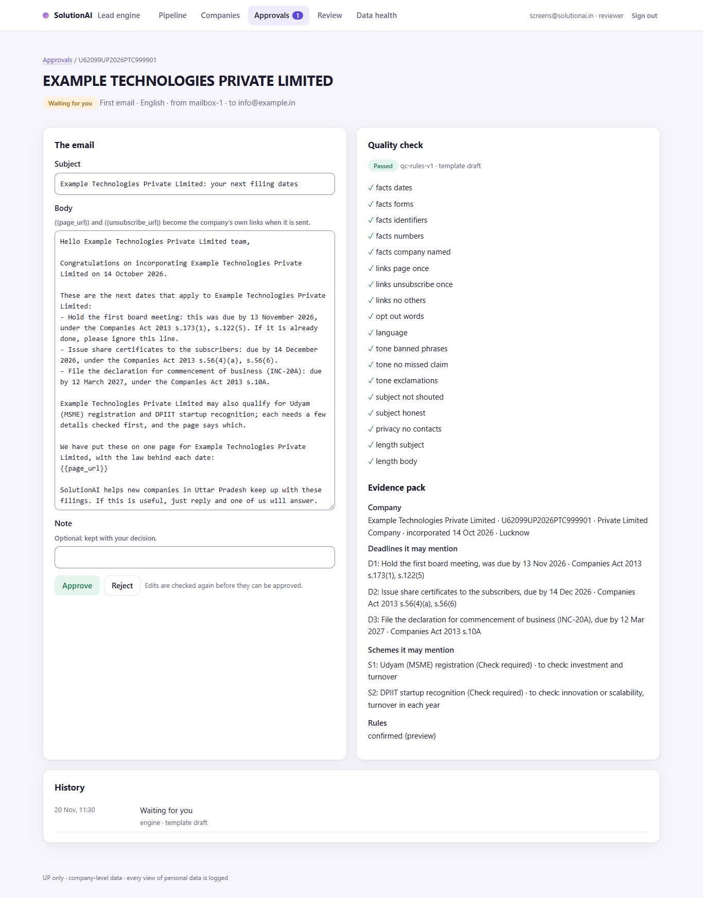
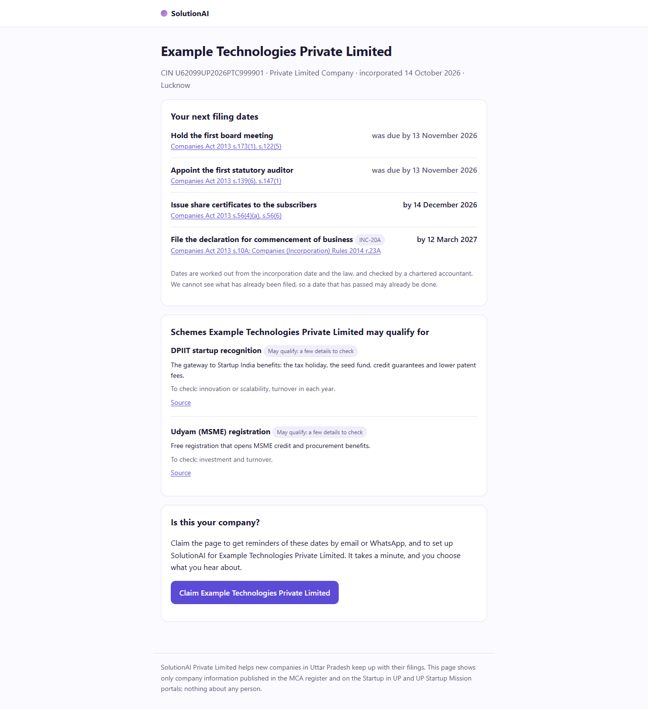
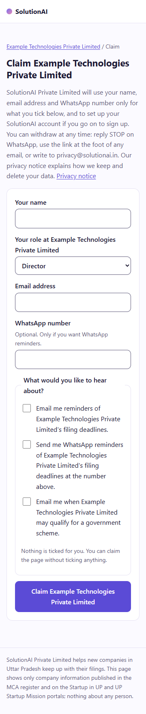

# Phase 3 report: outreach and the company page

**Period:** 9 – 15 November 2026 (built ahead of schedule, 1 November). **Prepared by:** Gourav Bathwal.
**Status:** code complete and tested. No founder has been contacted, by design. Three things hold every message until people say otherwise:
- a CA's sign-off on the rules;
- the mailboxes' warm-up, which ends on 18 November;
- the outbox, which writes emails to files until the mailboxes are configured for sending.

The owner actions are in `ops/WEEK3_ACTIONS.md`.

**Tests: 411, all passing** (162 Node.js, 249 Python), up from 389. Phase 3 added 21 Node.js tests and covers each step a message goes through. Every suite runs against a real MongoDB 8.0 that it starts and throws away.

---

## What was planned

From the design document, section 12, Phase 3 covers:
- the job scheduler and sequences;
- AI drafting from evidence packs, a quality check and the approval queue;
- the compliance gate;
- email sending with automatic pause;
- the company page and claim flow;
- WhatsApp utility templates, submitted and wired in;
- platform notifications.

## What was built

| Item | Where | Tests |
|---|---|---|
| **Sequences** on the job table: a daily plan queues a first email for each shortlisted company and a follow-up after 7 days; a step told to wait goes back to the queue without using up an attempt | `services/src/outreach/sequence.js`, `jobs/queue.js` (`defer`), `jobs/worker.js` (`DeferError`) | 6 |
| **Evidence packs**: the only facts a message may use: company-level facts, the next firm deadlines and the schemes that may apply, each with its law and source | `outreach/evidence.js` | 2 |
| **Drafting** in English or Hindi: the gateway's strong model when it is configured, reviewed templates otherwise, and the templates again whenever an AI draft fails the check twice | `outreach/draft.js`, `templates.js`, `llm.js` | 2 |
| **Quality check**: 18 rules in code, plus an AI review recorded as advice only | `outreach/qc.js` | 2 |
| **Approval queue** in the Admin pages, with a JSON twin: approve, edit and approve, reject, record what came back | `admin/approvals.js`, `admin/views.js` | 3 |
| **Compliance gate**: deterministic checks at the moment of sending | `outreach/gate.js`, `outreach/budget.js` | in the sequence tests |
| **Email**: plain text with one-click unsubscribe headers, a small SMTP client for the Zoho mailboxes, an outbox for dry runs, hard bounces handled at once | `outreach/mime.js`, `smtp.js`, `transport.js` | 2 |
| **Company page, claim and unsubscribe**: the pages founders see, consent recorded in the ledger with the exact words shown | `services/src/public/` | 3 |
| **WhatsApp**: four utility templates ready to submit, the Cloud API client, Meta's status read back, reminders only with consent | `config/whatsapp_templates.json`, `outreach/whatsapp.js`, `reminders.js` | 1 |
| **Platform**: pre-filled sign-up after a claim, and notifications for signed-up founders, both with safe fallbacks | `outreach/platform.js`, `docs/PLATFORM_CONTRACTS.md` | in the claim test |
| **Schema**: three new collections (`messages`, `page_tokens`, `channel_templates`), now 21 collections and 56 indexes | `schema/collections.json` | in the schema tests |

## How an email is made

1. **Plan** (06:30 every day). Every company on the month's shortlist that can be contacted and has a registered email gets a draft job. The registered email comes from the ₹5 vendor profile, which is published under the Companies Act. Seven days after a first email with no reply, its follow-up gets one too.
2. **Evidence pack.** The company's name, CIN, incorporation date and district are packed with:
   - up to three firm deadlines: those due in the next 120 days, and those that passed in the last 45 days, phrased "was due by";
   - up to two schemes that may apply.

   Conditional and ongoing obligations are never mentioned, because a message must not say something applies when it may not.
3. **Draft.** The templates or the AI write from the pack alone. The signature and the opt-out paragraph are fixed text the AI must copy.
4. **Quality check.** Every date, number, form name and identifier in the draft must be in the pack. Also checked:
   - the company is named;
   - the page link and the unsubscribe link each appear once, with no other links;
   - the language is the one asked for;
   - no banned phrase, no claim that a filing was missed, at most one exclamation mark;
   - no email address or phone number, an honest subject, and lengths within limits.
5. **A person approves**, edits or rejects the draft in the Admin approval queue, with the evidence pack and every check beside it. An edit is checked again. The approval records a hash of exactly the approved text.
6. **Compliance gate**, at the moment of sending (below).
7. **Send.** The company's own unguessable page link and unsubscribe link replace the placeholders. The email goes out, is logged as a 'sent' activity, and the lead becomes "contacted".

This is the first email the templates write, for an example company:

> Hello Example Technologies Private Limited team,
>
> Congratulations on incorporating Example Technologies Private Limited on 14 October 2026.
>
> These are the next dates that apply to Example Technologies Private Limited:
> - Hold the first board meeting: this was due by 13 November 2026, under the Companies Act 2013 s.173(1), s.122(5). If it is already done, please ignore this line.
> - Issue share certificates to the subscribers: due by 14 December 2026, under the Companies Act 2013 s.56(4)(a), s.56(6).
> - File the declaration for commencement of business (INC-20A): due by 12 March 2027, under the Companies Act 2013 s.10A.
>
> Example Technologies Private Limited may also qualify for Udyam (MSME) registration and DPIIT startup recognition; each needs a few details checked first, and the page says which.
>
> We have put these on one page for Example Technologies Private Limited, with the law behind each date: *(the company's link)*
>
> SolutionAI helps new companies in Uttar Pradesh keep up with these filings. If this is useful, just reply and one of us will answer.
>
> *(sender's name and title)*
>
> You are getting this email because Example Technologies Private Limited's registered email address is published in the Ministry of Corporate Affairs register. If you would rather not hear from us, reply "unsubscribe" or use this link and we will not write again: *(the unsubscribe link)*

## What the compliance gate checks

The gate is code, not AI, and runs after every AI step, so nothing can go around it (design 7.5). Each answer is one of three:
- **send:** every check passed;
- **wait:** the job goes back to the queue for the time given, without using up an attempt;
- **stop:** the message will never be sent, and the Admin page says why.

| Check | If it fails |
|---|---|
| Approved, and the text is exactly what was approved | stop |
| Not older than 14 days, and no date it calls upcoming has passed | stop |
| The rules are confirmed by a CA | wait, and look again the next sending day |
| The recipient's address has a legal basis this message accepts | stop |
| The sending mailbox is configured, and today is a sending day (Monday to Friday) | wait |
| Neither the address nor its domain is suppressed (an unreadable address counts as suppressed) | stop |
| Contact budget: not a holdout, eligible, no reply, opt-out, claim or hard bounce, one first email and one follow-up | stop |
| The warm-up is over (from 18 November), inside 10:00–17:30 IST, under the mailbox's daily cap (25, then 30) | wait until the warm-up ends, the window opens or the next day |
| The mailbox is not paused for bounces (over 2%) or complaints (over 0.1%) | wait a day |

**Sending happens at most once.** A message is marked "sending" before it is handed to the mail server. If a worker dies mid-send, the message is marked "check the mailbox" and is never sent again by itself. A person looks in the Sent folder and records the answer with one button; "not sent" puts it back through the gate. A temporary failure is retried. A permanent refusal of the address is a hard bounce: the address is suppressed and the bounce counts against the mailbox at once.

**Replies and bounces that arrive later** are recorded by a person on the message's page ("They replied", "It bounced", "They complained") until Phase 4 reads them from the mailbox. A reply hands the company to a person. A bounce or a complaint also suppresses the address.

## The company page, the claim and unsubscribing

Each email carries two links of its own, each 128 random bits. Only a hash of each is stored, and both expire after 120 days.

- **The company page** shows only company-level facts:
  - the next firm deadlines with their law and source;
  - the schemes the company may qualify for, with what needs checking;
  - a "claim your company" button.

  Until a CA confirms the rules, it says the dates are being checked instead of showing them. A visit is counted at most once a day per link, with no cookie and no address kept.
- **The claim form** asks for a name, a role, an email address and, optionally, a WhatsApp number, and offers three choices. Nothing is ticked for the founder:
  - email reminders of filing deadlines;
  - WhatsApp reminders of filing deadlines;
  - an email when a scheme may apply.

  Each tick is written to the consent ledger with the exact words shown. The proof holds only references: a hash of the link, the form and notice versions, and a keyed hash of the address. The person is stored with consent as the legal basis, any cold email still waiting is withdrawn, and the founder is handed to the platform's pre-filled sign-up, or to the normal sign-up until that endpoint exists.
- **Unsubscribing** takes one click from the email client (RFC 8058), or one button on the page. Opening the link alone changes nothing, because link scanners open links. The address is suppressed at once, the lead is closed and anything still queued is stopped.

The pages serve no JavaScript and send no Referer, because the links are capabilities. They tell search engines not to index them, limit wrong links and claims per address, and sign their forms.

**Accessibility:** axe-core (WCAG 2.2 AA and best practice) finds nothing on any of the five new pages:
- the company page, the claim form and the unsubscribe page;
- the approval queue and a message page.

That holds in light mode, in dark mode and at 360 pixels, with no sideways scrolling. A founder claimed a page end to end in a real browser, and the two consents arrived in the ledger.

## WhatsApp and reminders

- **Four utility templates**, in English and Hindi, are ready to submit to Meta (`config/whatsapp_templates.json`):
  - a deadline reminder, with a button to the company's page;
  - a confirmation after opting in.

  None is promotional. `whatsapp:templates --sync` reads Meta's status and quality rating back, and only an approved template is ever sent, so a template Meta pauses stops at once.
- **Reminders** go 7 days and 1 day before each confirmed, firm deadline, to founders who asked for them:
  - at most 6 a month per channel;
  - WhatsApp only between 09:00 and 21:00 IST;
  - within the month's WhatsApp cap (₹150, about 1,000 utility messages).

  Every send checks again that consent stands and the number is not suppressed. Email reminders go through the platform's own mail, never the outreach mailboxes.
- **Without Meta's keys**, WhatsApp messages are written to the outbox and nothing is sent.

## AI and its cost

- **The gateway is used only when configured**, and only for drafting the shortlisted companies' emails and an advisory review of each draft.
- **Spending is reserved before each call** against the month's cap (₹400) and the company's token budget. If either would be passed, nothing is called, and the templates write the email instead.
- **Every call is logged** in `llm_calls` with its model, tokens, cost and latency.
- **What the AI may say:** the prompt gives the model only the evidence pack and the fixed paragraphs.
- **When the AI fails:** a draft that fails the rules twice is replaced by the template draft.
- **The AI review is advice only.** It is shown to the approver and never decides anything, until its answers have been shown to agree with the reviewers'.

## On the real data

`outreach:plan` for October's shortlist finds 200 companies to contact and 0 with an address. The registered emails come with the ₹5 vendor profiles, which wait for the vendor key (Week 2 actions, item 1). The first drafts appear the morning after the profiles are bought.

## Decisions taken in the code

- **Every email is approved by a person** (`approval.mode: all`). Sampling only comes once the quality check is shown to agree with the reviewers (design 7.5).
- **Nothing reaches a founder unconfirmed.** The gate holds every email until a CA confirms the rules, and the company page shows no dates until then.
- **The registered email is the only cold address**, with "published under law" as its basis. A person's address there (a Gmail, say) is shown as such to the approver.
- **Plain-text email only:** no HTML, no images, no tracking pixel. A page visit is the only engagement signal, and it is counted without a cookie.
- **Weekdays only, 10:00–17:30 IST**, from the mailbox the company was first given. A follow-up goes in the same thread, from the same mailbox.
- **English by default.** Hindi templates exist and pass the same check. Nothing yet says which founders prefer Hindi, so `default_language` in `config/outreach.json` decides.
- **The SMTP client is the engine's own** (about 150 lines, no dependency), so that a refused address is seen and acted on immediately.

## What is left for Phase 4

- **Reading replies and bounces from the mailboxes**, and classifying replies. A person records them until then.
- **New-need messages** (a new deadline or scheme after the first contact). The contact budget already has their rules; drafting them comes with Phase 4.
- **The voice agent**, attribution of payments and service requests, monitoring and alerts, and the test sets.

## What waits on others

See `ops/WEEK3_ACTIONS.md`. In short:
1. the mailboxes' addresses and SMTP app passwords;
2. the company pages' web address behind the platform's proxy;
3. the privacy notice and a contact for withdrawals;
4. the four WhatsApp templates submitted to Meta;
5. the platform's onboarding and notification endpoints, and the LLM gateway key;
6. a short legal review before the first email on 18 November (design 11);
7. the CA's sign-off, as before.
